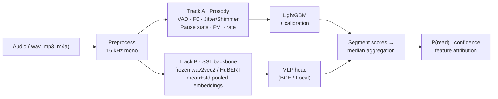

<div align="center">

# 🎙️ VoiceVeritas

**Detect whether an interview answer is being read from a script — or genuinely spoken.**

**检测面试回答是"照稿朗读"还是"真实作答"。**

[](https://github.com/StanleyChanH/VoiceVeritas/actions/workflows/ci.yml)
[](LICENSE)
[](pyproject.toml)
[](https://github.com/astral-sh/ruff)

*Audio-only read-speech detection for AI interview anti-cheating.*

</div>

---

## Why / 为什么做这个

Online interviews are increasingly vulnerable to a simple cheat: the candidate **reads a prepared answer** (or a ChatGPT-generated one) off-screen. Human reviewers struggle to tell scripted from spontaneous speech reliably — but the acoustic signatures differ measurably.

在线面试中，候选人**照着屏幕朗读准备好的答案**（或 AI 生成的答案）是常见的作弊手段。人耳难以稳定区分朗读与即兴表达，但两者的声学签名是可测量的。

VoiceVeritas is an **open-source, audio-only** system that takes an interview answer recording and returns:

VoiceVeritas 是一个**开源、纯音频**的系统，输入一段面试回答录音，输出：

```
P(read | audio) ∈ [0, 1]   —   该音频为"朗读/背诵"的概率
```

plus per-segment scores, confidence, and (for the interpretable baseline) the prosodic cues that drove the decision.

以及分段评分、置信度，以及（可解释基线模型）驱动判断的韵律线索。

> 📌 **State of research** — the approach follows the SLT 2024 paper [*Classification of Spontaneous and Scripted Speech for Multilingual Audio*](https://arxiv.org/abs/2412.11896): frozen pretrained speech-transformer embeddings + a light classifier beat handcrafted prosodic features. To our knowledge, **no open-source implementation of interview read-speech detection existed before this project.**

## Architecture / 架构



- **Track A (interpretable baseline)**: energy VAD + ~50 prosodic handcrafted features (F0 statistics, jitter, shimmer, pause/silence distribution, PVI, articulation-rate variance) → LightGBM with isotonic calibration.
- **Track B (performance)**: frozen self-supervised backbone ([wav2vec 2.0](https://arxiv.org/abs/2006.11477)) embeddings, chunk-level scoring, median aggregation — the SOTA recipe from the literature.
- **Metrics that respect candidates**: besides AUC-ROC/AUC-PR we report **EER and FPR@TPR95**, because flagging a fluent honest candidate is worse than missing a subtle reader.

## Quickstart / 快速开始

```bash
# 1. Install (Python 3.10+, we recommend uv)
uv sync --extra api --extra deep      # or: pip install -e ".[api,deep]"

# 2. Predict on a single file
vv predict path/to/answer.wav

# 3. Prepare public benchmark data + train the baseline
vv prepare --dataset librispeech --subset dev-clean
vv prepare --dataset sbcsae
vv train --config configs/baseline.yaml
vv eval  --run runs/<your-run>

# 4. Serve the REST API
vv serve --model runs/<your-run>   # Swagger UI at http://localhost:8000/docs
```

<details>
<summary><b>API example</b></summary>

```bash
curl -X POST http://localhost:8000/v1/predict \
  -F "audio=@answer.wav" \
  -F "reference_text=optional... (unused by audio-only models)"
```

```json
{
  "read_probability": 0.87,
  "label": "read",
  "confidence": 0.72,
  "segmented_scores": [0.81, 0.89, 0.91],
  "processing_ms": 184,
  "model": {"name": "prosody-lgbm", "version": "0.1.0"}
}
```

</details>

## Repository layout / 仓库结构

```
src/voiceveritas/     core package (audio IO, VAD, features, models, training, API)
configs/              experiment configs (baseline / deep)
scripts/              dataset preparation & benchmarking utilities
docs/                 usage, data, benchmark, model card, ethics charter
tests/                unit + integration tests on synthetic fixtures
```

## Documentation / 文档

- [Usage guide](docs/usage.md)
- [Dataset preparation](docs/data.md) — LibriSpeech, SBCSAE, CORAAL, AMI (licenses documented)
- [Benchmark results](docs/benchmark.md)
- [Model card](docs/model_card.md)
- [**Ethics & responsible use**](docs/ethics.md) — **read this before deploying**

## Status & roadmap / 状态与路线图

- [x] M0 — repo skeleton, CI, community files
- [ ] M1 — audio IO + manifests + speaker-disjoint splits
- [ ] M2 — VAD + prosodic feature extractor
- [ ] M3 — training / evaluation pipeline
- [ ] M4 — real-data benchmark (LibriSpeech vs SBCSAE)
- [ ] M5 — wav2vec2 frozen-embedding deep track
- [ ] M6 — CLI + FastAPI service + Docker
- [ ] M7 — model card, docs, v0.1.0 release
- [ ] i18n — Chinese spontaneous-speech datasets, multilingual eval
- [ ] ASR-alignment features (WhisperX forced alignment, optional extra)

## Contributing / 贡献

Issues and PRs are welcome — see [CONTRIBUTING.md](CONTRIBUTING.md). Please read the [ethics charter](docs/ethics.md) first: this tool is built to **assist fair human review, not to automate rejection**.

## License

[Apache-2.0](LICENSE). Trained-model weights and manifests inherit their training-data licenses (see [docs/data.md](docs/data.md)).

## Citation

```bibtex
@software{voiceveritas2025,
  title  = {VoiceVeritas: open-source read-speech detection for interview anti-cheating},
  author = {VoiceVeritas Contributors},
  year   = {2025},
  url    = {https://github.com/StanleyChanH/VoiceVeritas}
}
```
