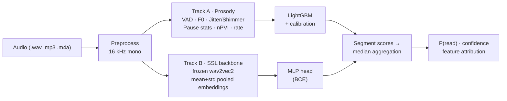

<div align="center">

# 🎙️ VoiceVeritas

**Detect whether an interview answer is being read from a script — or genuinely spoken.**

[](https://github.com/StanleyChanH/VoiceVeritas/actions/workflows/ci.yml)
[](LICENSE)
[](pyproject.toml)
[](https://github.com/astral-sh/ruff)

*Audio-only read-speech detection for AI interview anti-cheating.*

**English** | [简体中文](README.zh-CN.md)

</div>

---

## Why

Online interviews are increasingly vulnerable to a simple cheat: the candidate **reads a prepared answer** (or a ChatGPT-generated one) off-screen. Human reviewers struggle to tell scripted from spontaneous speech reliably — but the acoustic signatures differ measurably.

VoiceVeritas is an **open-source, audio-only** system that takes an interview answer recording and returns

```
P(read | audio) ∈ [0, 1]   —   the probability the audio was read/recited
```

plus per-segment scores, confidence, and (for the interpretable baseline) the prosodic cues that drove the decision.

> 📌 **State of research** — the approach follows the SLT 2024 paper [*Classification of Spontaneous and Scripted Speech for Multilingual Audio*](https://arxiv.org/abs/2412.11896): frozen pretrained speech-transformer embeddings + a light classifier beat handcrafted prosodic features. To our knowledge, **no open-source implementation of interview read-speech detection existed before this project.**

> 🌐 **Scope: English speech.** The project targets English interview audio only — by design, not by omission. Speech-style cues (pause rhythm, F0 dynamics, disfluency patterns) are language-specific; extending to other languages requires *native spontaneous+read corpora per language*, not just machine translation of docs. PRs for new languages are welcome following [data.md](docs/data.md).

## Results

Speaker-disjoint benchmark (LibriSpeech *read* vs AMI *spontaneous*, 65 test utterances from unseen speakers; full details & caveats in [benchmark.md](docs/benchmark.md)):

| Model | Test AUC-ROC | EER | FPR@TPR95 |
|---|---|---|---|
| Track A · prosody + LightGBM (interpretable) | **0.978** | 4% | 4% |
| Track A · + noise-aware augmentation (default) | **0.998** | 4% | 4% |
| Track A+ASR · + lexical/alignment features (`[asr]` extra) | **0.998** | 5% | **0%** |
| Track B · frozen wav2vec2-base + MLP | **1.000** | 0% | 0% |
| **Ensemble** · median(prosody-aug, wav2vec-aug) | 0.997 | 7.5% | 4% |

Noise-robustness (white noise 10 dB): Track A 0.644 → 0.965 with
augmentation; Track B's white-noise inversion (0.137) fixed to **0.998**;
the robust ensemble holds **0.994**. Every prediction carries an
`estimated_snr_db` and a below-15 dB reliability warning. Latency (Track A
API, 10 s audio, CPU-only): **p50 243 ms** end-to-end.

```console
$ vv predict runs/<run>/model.joblib answer.wav
model             : prosody_lgbm
P(read)           : 0.000
verdict@0.5       : SPONTANEOUS
top contributors :
  speechseg_mean     -0.832   ← long speech runs = spontaneous planning
  pause_total_ratio  -0.776   ← natural pause structure
```

⚠️ These are *cross-domain* research numbers — recalibrate on your own traffic before any operational use ([ethics](docs/ethics.md)). **Neither track survives ≤10 dB SNR** — see the [robustness report](docs/robustness.md) before deploying.

## Architecture



- **Track A (interpretable baseline)**: energy VAD + 34 handcrafted prosodic features (F0 statistics, jitter, shimmer, pause/silence distribution, nPVI rhythm, syllable-rate variability) → LightGBM with isotonic calibration.
- **Track B (performance)**: frozen self-supervised backbone ([wav2vec 2.0](https://arxiv.org/abs/2006.11477)) embeddings, chunk-level scoring, median aggregation — the SOTA recipe from the literature.
- **Metrics that respect candidates**: besides AUC-ROC/AUC-PR we report **EER and FPR@TPR95**, because flagging a fluent honest candidate is worse than missing a subtle reader.

## Quickstart

**Option A — pretrained model, zero training** (Track A, ~140 KB artifact):

```bash
curl -L -o model.joblib \
  https://github.com/StanleyChanH/VoiceVeritas/releases/download/v0.1.1/voiceveritas-prosody-lgbm-v0.1.1.joblib
uv run vv predict model.joblib answer.wav
```

**Option B — reproduce the full pipeline:**

```bash
# 1. Install (Python 3.10+; uv recommended — or: pip install -e ".[api,deep]")
uv sync --extra api --extra deep

# 2. Prepare the public benchmark data (~750 MB) and train the baseline
uv run vv prepare librispeech --download
uv run vv prepare ami --download
cat data/manifests/librispeech.jsonl data/manifests/ami.jsonl > data/manifests/benchmark.jsonl
uv run vv train --config configs/baseline.yaml

# 3. Score a single file (segment scores + feature attribution)
uv run vv predict runs/<timestamp>_baseline/model.joblib answer.wav

# 4. Serve the REST API (Swagger UI at http://localhost:8000/docs)
uv run vv serve runs/<timestamp>_baseline

# 5. Stress a model under noise / telephony / resampling conditions
uv run vv robustness runs/<timestamp>_baseline --manifest data/manifests/benchmark.jsonl
```

<details>
<summary><b>API example</b></summary>

```bash
curl -X POST http://localhost:8000/v1/predict \
  -F "audio=@answer.wav" \
  -F "reference_text=optional (reserved, unused by audio-only models)"
```

```json
{
  "read_probability": 0.87,
  "label": "read",
  "confidence": 0.72,
  "segmented_scores": [{"start_s": 0, "end_s": 25.7, "score": 0.87}],
  "processing_ms": 184,
  "model": {"name": "prosody_lgbm", "package_version": "0.1.0"}
}
```

</details>

## Repository layout

```
src/voiceveritas/     core package (audio IO, VAD, features, models, training, API)
configs/              experiment configs (baseline / deep)
scripts/              benchmarking utilities & serve entrypoint
docs/                 usage, data, benchmark, model card, ethics charter
tests/                unit + integration tests on synthetic fixtures
```

## Documentation

- [Usage guide](docs/usage.md)
- [Dataset preparation](docs/data.md) — LibriSpeech, AMI, SBCSAE, CORAAL (licenses documented)
- [Benchmark results](docs/benchmark.md) — including the shortcut-learning postmortem
- [Robustness report](docs/robustness.md) — noise/telephony/resampling stress tests
- [Model card](docs/model_card.md)
- [**Ethics & responsible use**](docs/ethics.md) — **read this before deploying**

## Status & roadmap

- [x] Dual-track models, speaker-disjoint benchmark, CLI + FastAPI + Docker
- [x] Robustness suite — noise/SNR/bitrate stress tests + honest degradation report
- [x] Pretrained release — Track-A artifact on the [releases](https://github.com/StanleyChanH/VoiceVeritas/releases) page
- [x] ASR lexical/alignment features — fillers, pause-syntax misalignment, formality (faster-whisper; `[asr]` extra)
- [x] Noise-aware training (on by default) + SNR estimation & reliability warnings in every prediction
- [x] Noise-robust deep track (inversion fixed) + median ensembles (`vv ensemble`)
- [ ] WhisperX character-level forced alignment (finer pause-syntax features)
- [ ] Noise-augmented ASR track (lexical features under noise)

## Contributing

Issues and PRs are welcome — see [CONTRIBUTING.md](CONTRIBUTING.md). Please read the [ethics charter](docs/ethics.md) first: this tool is built to **assist fair human review, not to automate rejection**.

## License

[Apache-2.0](LICENSE). Trained-model weights and manifests inherit their training-data licenses (see [docs/data.md](docs/data.md)).

## Citation

```bibtex
@software{voiceveritas2025,
  title  = {VoiceVeritas: open-source read-speech detection for interview anti-cheating},
  author = {VoiceVeritas Contributors},
  year   = {2025},
  url    = {https://github.com/StanleyChanH/VoiceVeritas}
}
```
