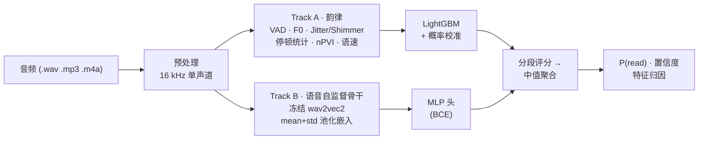

<div align="center">

# 🎙️ VoiceVeritas

**检测面试回答是"照稿朗读"还是"真实作答"。**

[](https://github.com/StanleyChanH/VoiceVeritas/actions/workflows/ci.yml)
[](LICENSE)
[](pyproject.toml)
[](https://github.com/astral-sh/ruff)

*纯音频的 AI 面试读稿检测系统。*

[English](README.md) | **简体中文**

</div>

---

## 为什么做这个

在线面试正面临一种简单直接的作弊手段：候选人**照着屏幕朗读事先准备好的答案**（或 AI 生成的答案）。人工审核者很难稳定地区分朗读与即兴表达——但两者的声学签名是可客观测量的。

VoiceVeritas 是一个**开源、纯音频**的系统，输入一段面试回答录音，输出：

```
P(read | audio) ∈ [0, 1]   —   该音频为"朗读/背诵"的概率
```

同时输出分段评分、置信度，以及（可解释基线模型）驱动判断的韵律线索。

> 📌 **研究现状** —— 方法论基于 SLT 2024 论文 [*Classification of Spontaneous and Scripted Speech for Multilingual Audio*](https://arxiv.org/abs/2412.11896)：冻结的预训练语音大模型嵌入 + 轻量分类头优于手工韵律特征。据我们所知，**在此项目之前，GitHub 上不存在面试读稿检测的开源实现。**

## 结果

说话人不相交基准（LibriSpeech *朗读* vs AMI *自发*，65 条来自未见说话人的测试音频；完整细节与注意事项见 [benchmark.md](docs/benchmark.md)）：

| 模型 | Test AUC-ROC | EER | FPR@TPR95 |
|---|---|---|---|
| Track A · 韵律特征 + LightGBM（可解释） | **0.978** | 4% | 4% |
| Track B · 冻结 wav2vec2-base + MLP | **1.000** | 0% | 0% |

延迟（Track A API，10 秒音频，纯 CPU）：端到端 **p50 243 ms**。

```console
$ vv predict runs/<run>/model.joblib answer.wav
model             : prosody_lgbm
P(read)           : 0.000
verdict@0.5       : SPONTANEOUS
top contributors :
  speechseg_mean     -0.832   ← 长语音段 = 即兴思考
  pause_total_ratio  -0.776   ← 自然的停顿结构
```

⚠️ 以上是**跨域**研究数字——任何生产使用前，请先在你自己的真实流量上重新校准（[伦理章程](docs/ethics.md)）。

## 架构



- **Track A（可解释基线）**：能量 VAD + 34 维手工韵律特征（F0 统计量、jitter、shimmer、停顿/静音分布、nPVI 节奏、音节速率波动）→ LightGBM + isotonic 校准。
- **Track B（性能上限）**：冻结自监督骨干网络（[wav2vec 2.0](https://arxiv.org/abs/2006.11477)）嵌入、分段打分、中值聚合——文献验证过的 SOTA 方案。
- **尊重候选人的指标**：除 AUC-ROC/AUC-PR 外，我们报告 **EER 与 FPR@TPR95**——把表达流利的诚实候选人误判为读稿，比漏掉一个隐蔽的读稿者代价更高。

## 快速开始

```bash
# 1. 安装（Python 3.10+；推荐 uv —— 或: pip install -e ".[api,deep]"）
uv sync --extra api --extra deep

# 2. 准备公开基准数据（约 750 MB）并训练基线
uv run vv prepare librispeech --download
uv run vv prepare ami --download
cat data/manifests/librispeech.jsonl data/manifests/ami.jsonl > data/manifests/benchmark.jsonl
uv run vv train --config configs/baseline.yaml

# 3. 单文件打分（分段评分 + 特征归因）
uv run vv predict runs/<timestamp>_baseline/model.joblib answer.wav

# 4. 启动 REST API（Swagger UI: http://localhost:8000/docs）
uv run vv serve runs/<timestamp>_baseline
```

<details>
<summary><b>API 示例</b></summary>

```bash
curl -X POST http://localhost:8000/v1/predict \
  -F "audio=@answer.wav" \
  -F "reference_text=可选（预留字段，纯音频模型暂不使用）"
```

```json
{
  "read_probability": 0.87,
  "label": "read",
  "confidence": 0.72,
  "segmented_scores": [{"start_s": 0, "end_s": 25.7, "score": 0.87}],
  "processing_ms": 184,
  "model": {"name": "prosody_lgbm", "package_version": "0.1.0"}
}
```

</details>

## 仓库结构

```
src/voiceveritas/     核心包（音频 IO、VAD、特征、模型、训练、API）
configs/              实验配置（baseline / deep）
scripts/              基准测试工具与容器入口
docs/                 使用、数据、基准、模型卡、伦理章程
tests/                基于合成夹具的单元 + 集成测试
```

## 文档

- [使用指南](docs/usage.md)
- [数据集准备](docs/data.md) —— LibriSpeech、AMI、SBCSAE、CORAAL（含许可证说明）
- [基准结果](docs/benchmark.md) —— 含"捷径学习"复盘
- [模型卡](docs/model_card.md)
- [**伦理与负责任使用**](docs/ethics.md) —— **部署前必读**

## 状态与路线图

- [x] 双轨模型、说话人不相交基准、CLI + FastAPI + Docker
- [x] v0.1.0 已发布（见 [releases](https://github.com/StanleyChanH/VoiceVeritas/releases)）
- [ ] i18n —— 中文自发语音数据集、多语言评测
- [ ] ASR 对齐特征（WhisperX 强制对齐，可选依赖）
- [ ] 鲁棒性套件 —— 噪声/信噪比/码率压力测试
- [ ] 预训练发布 —— 提供开箱即用的模型产物

## 贡献

欢迎 Issue 与 PR——见 [CONTRIBUTING.md](CONTRIBUTING.md)。请先阅读[伦理章程](docs/ethics.md)：本工具旨在**辅助公平的人工审核，而非自动化拒人**。

## 许可证

[Apache-2.0](LICENSE)。训练所得模型权重与清单继承训练数据的许可证（见 [docs/data.md](docs/data.md)）。

## 引用

```bibtex
@software{voiceveritas2025,
  title  = {VoiceVeritas: open-source read-speech detection for interview anti-cheating},
  author = {VoiceVeritas Contributors},
  year   = {2025},
  url    = {https://github.com/StanleyChanH/VoiceVeritas}
}
```
